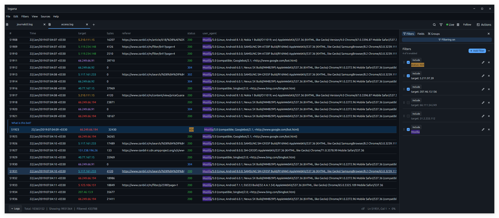
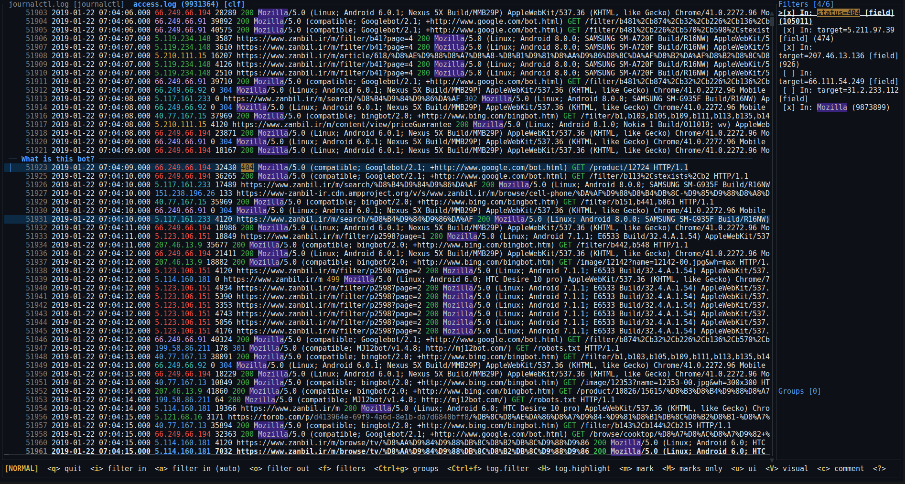

# logana

<p align="center">
  <a href="https://github.com/pauloremoli/logana/actions?query=workflow%3ARust"></a>
  <a href="https://codecov.io/gh/pauloremoli/logana"></a>
  <a href="https://crates.io/crates/logana"></a>
  <a href="https://crates.io/crates/logana"></a>
  <a href="https://github.com/pauloremoli/logana/blob/main/LICENSE"></a>
</p>

<p align="center">
  A fast log viewer for your terminal and desktop. Filter logs of any size and format, mark and annotate what matters, then export your findings.
</p>

<p align="center">
  
</p>

<p align="center">
  
</p>

- Native desktop GUI built with GPUI, plus a keyboard-driven terminal UI
- Any log format — JSON, syslog, logfmt, OpenTelemetry, DLT, or a custom schema
- Include/exclude/highlight filters — by text, regex, field, or date range
- Bookmark and annotate lines, then export to Markdown or Jira
- Vim-style navigation, fully remappable keybindings
- MCP server to expose your findings to AI assistants

---

## Installation

### Pre-built binaries (recommended)

Download from the [Releases page](https://github.com/pauloremoli/logana/releases), or use the install script:

**Linux / macOS**
```sh
curl -fsSL https://github.com/pauloremoli/logana/releases/latest/download/logana-installer.sh | sh
```

**Windows (PowerShell)**
```powershell
irm https://github.com/pauloremoli/logana/releases/latest/download/logana-installer.ps1 | iex
```

These install the TUI (`logana`). For the GUI only, swap in
`logana-gui-installer.sh` / `.ps1`; for both frontends, use
`logana-full-installer.sh` / `.ps1`.

### Debian / Ubuntu

Download the `.deb` for your architecture from the [Releases page](https://github.com/pauloremoli/logana/releases), then install it with APT:

```sh
sudo apt install ./logana_0.7.7-1_amd64.deb
```

Packages are available for amd64 and arm64: `logana` (TUI), `logana-gui`
(GUI), or `logana-full` (both). GUI packages include an application menu
launcher. Packages are built and tested on Ubuntu 24.04; other Debian/Ubuntu
releases need compatible runtime libraries.

### Homebrew (macOS / Linux)

####  TUI 

To install only the terminal UI instead:

```sh
brew tap pauloremoli/logana && brew install logana
```

#### GUI 
Install only the desktop GUI:

```sh
brew tap pauloremoli/logana
brew install logana-gui
logana-gui
```


### Cargo

```sh
# Run the TUI
cargo run
cargo install logana
# or install the latest binary directly
cargo binstall logana
```

Cargo installs the TUI (`logana`). For the desktop GUI, use the pre-built
GUI or full installers above, or build from a checkout of this repository:

```sh
# Run the desktop GUI
cargo run -p logana-gui
# Install only the desktop GUI from this checkout
cargo install --path crates/logana-gui --locked
# Build both the terminal and desktop applications
cargo build -p logana-full
```

Source builds enable `tui` by default. See
[frontend build configurations](CONTRIBUTING.md#frontend-features) for details.


## Documentation

Full documentation is at **[pauloremoli.github.io/logana](https://pauloremoli.github.io/logana/)**.

- [Quick Start](https://pauloremoli.github.io/logana/quick-start.html)
- [Commands](https://pauloremoli.github.io/logana/commands.html)
- [Filtering](https://pauloremoli.github.io/logana/filtering/)
- [Configuration](https://pauloremoli.github.io/logana/configuration/)
- [Keybindings](https://pauloremoli.github.io/logana/configuration/keybindings.html)
- [Annotations](https://pauloremoli.github.io/logana/annotations.html)
- [OTel Collector](https://pauloremoli.github.io/logana/otel.html)
- [MCP Server](https://pauloremoli.github.io/logana/mcp.html)
- [Log Formats](https://pauloremoli.github.io/logana/log-formats.html)
- [Custom Schemas](https://pauloremoli.github.io/logana/custom-schemas.html)
